# 3-Tier React App on MicroK8s (Helm + Nexus Registry)

A three-tier "Goals" app (React frontend, backend API, MongoDB) packaged as Docker images, stored in a private **Nexus** registry, and deployed to **MicroK8s** with a **Helm** chart.

## Architecture

| Tier | Component | Workload | Service (ClusterIP) |
|------|-----------|----------|---------------------|
| Frontend | React app | `frontend-deployment` (2 replicas) | `frontend-service` : 3000 |
| Backend | API | `backend-deployment` (2 replicas) | `backend-service` : 80 |
| Database | MongoDB | `mongo` StatefulSet (`mongo-0`, `mongo-1`) | `db-service` : 27017 |

## Tech Stack

- Docker, Sonatype Nexus Repository OSS 3.67.1
- MicroK8s (Calico CNI, containerd)
- Helm chart: `ganesh-app-0.1.0.tgz`
- Namespace: `threetierapp`

---

## 1. Push Images to Nexus

Registry: `192.168.0.120:8085` | Repository: `dockerrepo`

```bash
docker tag <backend-image-id>  192.168.0.120:8085/dockerrepo/backendpr:v1
docker tag <frontend-image-id> 192.168.0.120:8085/dockerrepo/frontendpr:v1

docker login 192.168.0.120:8085
docker push 192.168.0.120:8085/dockerrepo/backendpr:v1
docker push 192.168.0.120:8085/dockerrepo/frontendpr:v1
```

**Backend image push**

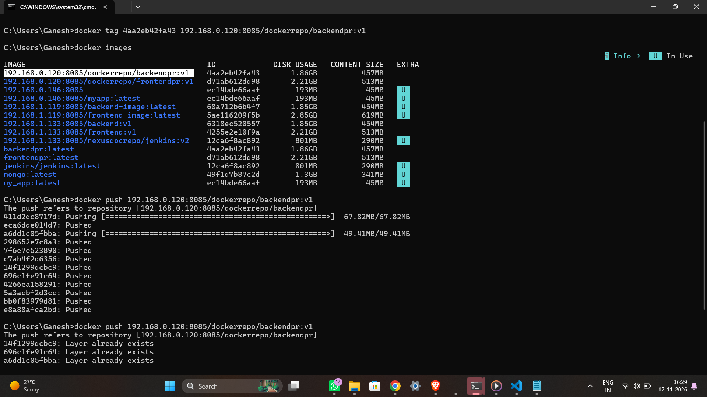

**Frontend image push**

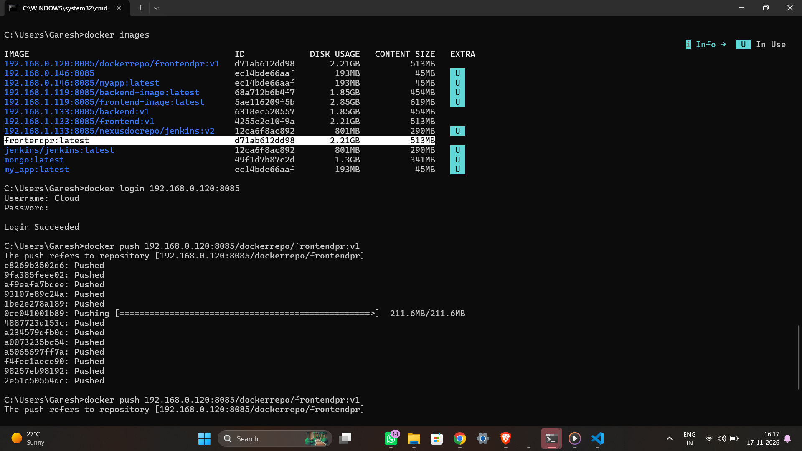

**Images available in the Nexus repository (`DockerRepo`)**

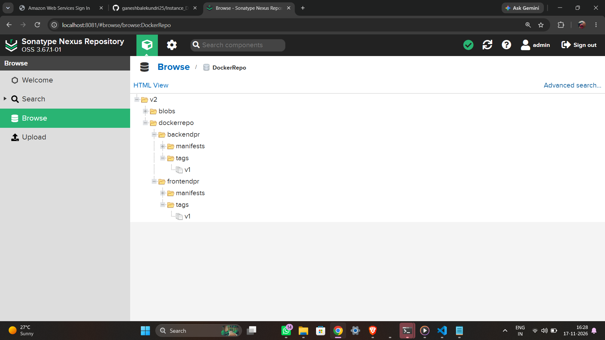

---

## 2. Deploy with Helm

```bash
helm install 3app ganesh-app-0.1.0.tgz
```

Release `3app` deployed successfully (revision 1).

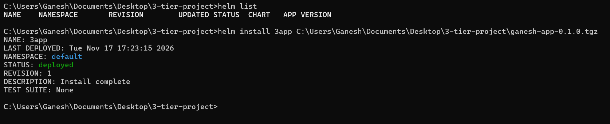

**Namespace `threetierapp` created**

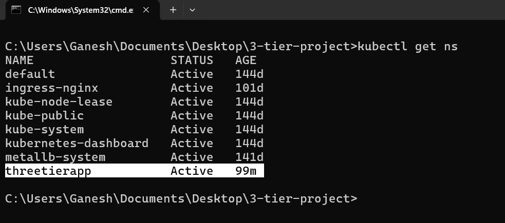

---

## 3. Issue Faced: `ImagePullBackOff`

### Problem

After deploying, the backend and frontend pods stayed in `ImagePullBackOff` (MongoDB pods ran fine):

```
Error: ImagePullBackOff
Back-off pulling image "192.168.0.120:8085/dockerrepo/backendpr:v1"
```

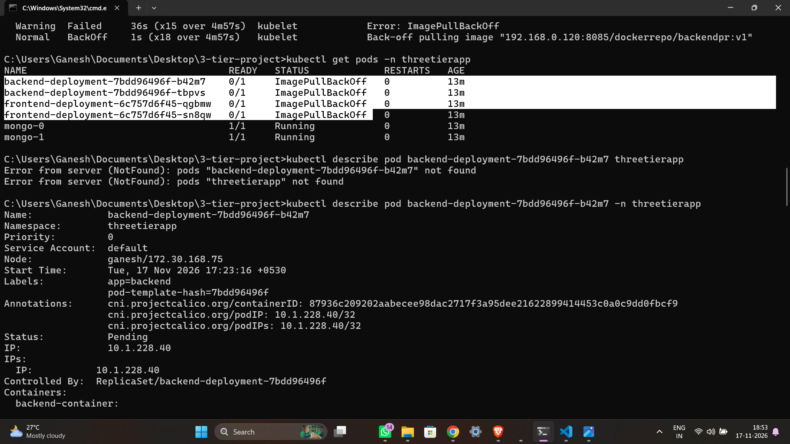

### Cause

MicroK8s uses **containerd**, not Docker, to pull images. It had no configuration for the Nexus registry (plain HTTP, not HTTPS), so the pull failed. `docker login` on the host does not affect containerd.

### Solution

Register the Nexus registry with containerd by creating this file on the MicroK8s node:

`/var/snap/microk8s/current/args/certs.d/192.168.0.120:8085/hosts.toml`

```toml
server = "http://192.168.0.120:8085"

[host."http://192.168.0.120:8085"]
  capabilities = ["pull", "resolve", "push"]
```

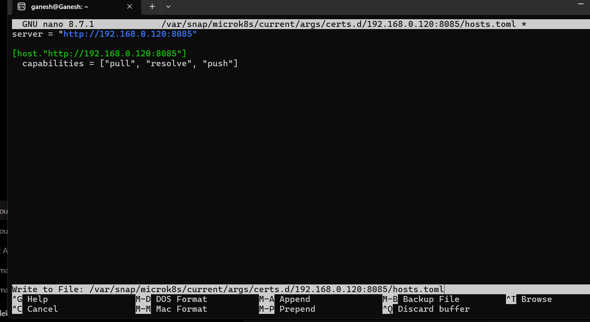

### Result

Pods moved from `ImagePullBackOff` to `ContainerCreating` to `Running`.

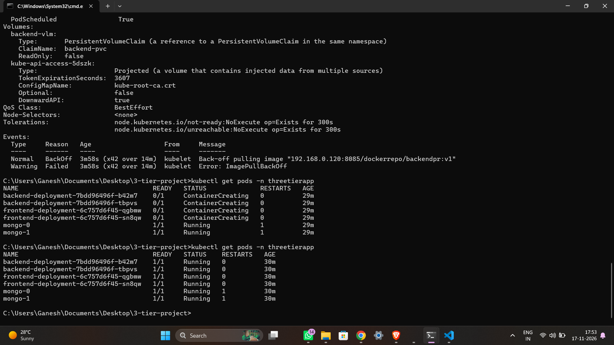

> If your Nexus repo requires authentication for pulls, also create an `imagePullSecret` and reference it in the deployments.

---

## 4. Verify the Deployment

**Pods (all `1/1 Running`):** 2x backend, 2x frontend, `mongo-0`, `mongo-1`

```bash
kubectl get pods -n threetierapp
```

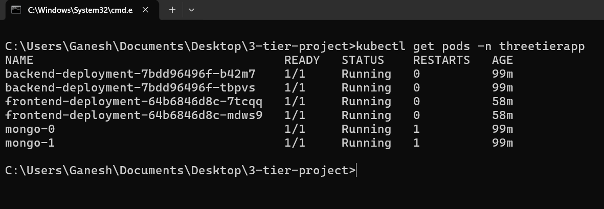

**Services**

```bash
kubectl get svc -n threetierapp
```

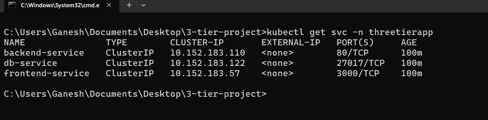

**Persistent storage (PV and PVC, all `Bound`)**

```bash
kubectl get pv
kubectl get pvc -n threetierapp
```

| PVC | Capacity | StorageClass | Reclaim | Used by |
|-----|----------|--------------|---------|---------|
| `backend-pvc` (PV `backend-pv`) | 1Gi | `manual` | Retain | Backend |
| `mongo-persistent-storage-mongo-0` | 5Gi | `microk8s-hostpath` | Delete | MongoDB |
| `mongo-persistent-storage-mongo-1` | 5Gi | `microk8s-hostpath` | Delete | MongoDB |

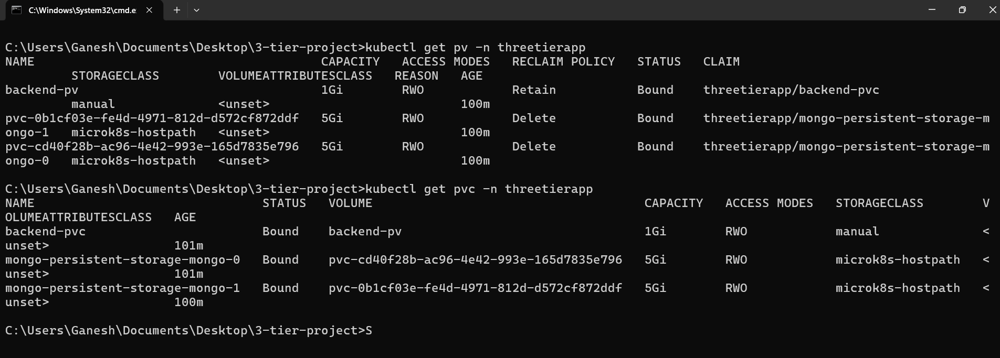

---

## 5. Access the App

The services are `ClusterIP`, so expose the frontend locally with port-forwarding:

```bash
kubectl port-forward svc/frontend-service 3000:3000 -n threetierapp
```

Open **http://localhost:3000**

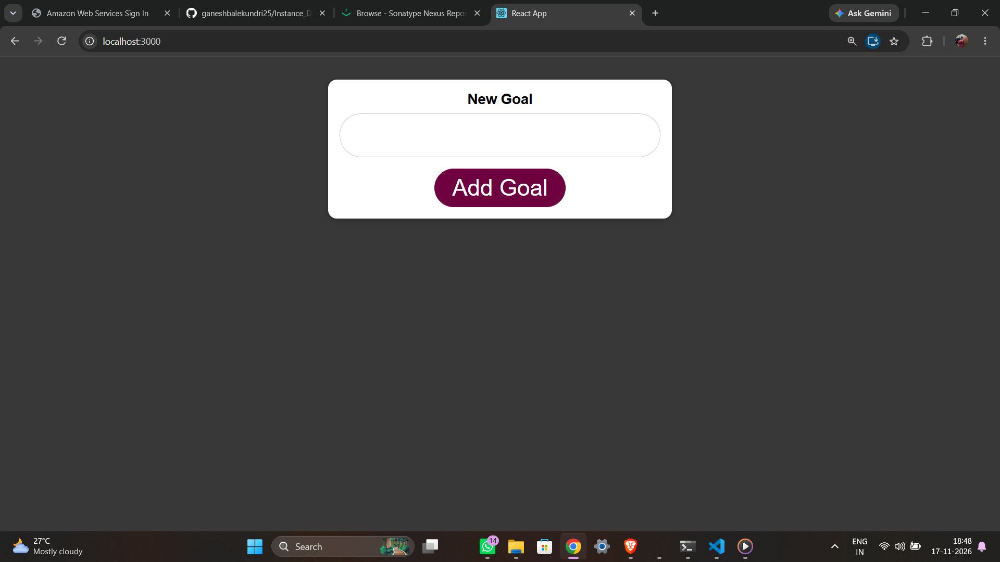

---

## Project Status

- Images built and pushed to Nexus
- Helm chart deployed to `threetierapp`
- `ImagePullBackOff` resolved via containerd `hosts.toml`
- All pods, services, PVs and PVCs healthy
- React frontend reachable on port 3000

## Author

Ganesh Balekundri- (AWS, Devops) GitHub: @ganeshbalekundri25
